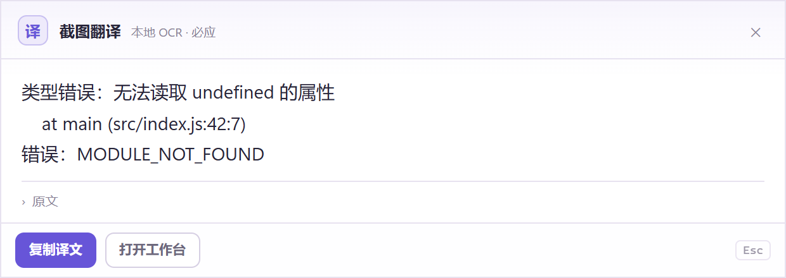
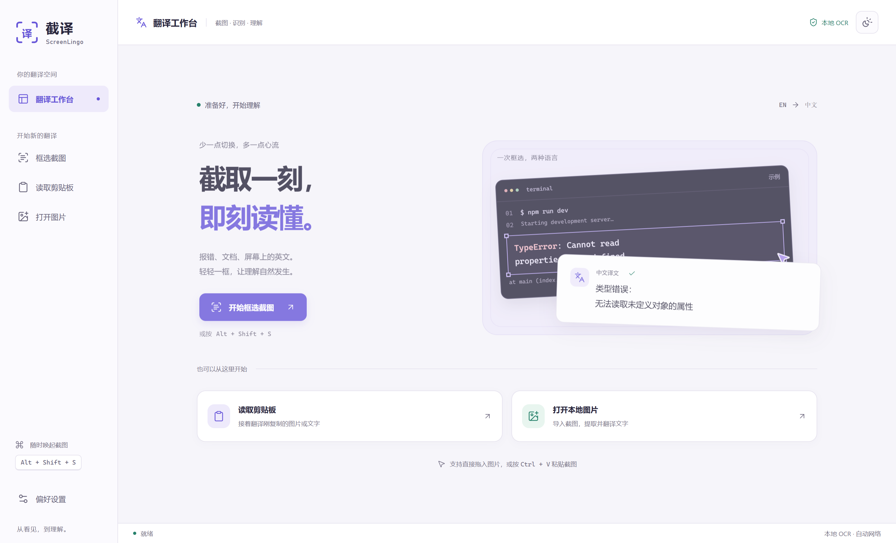
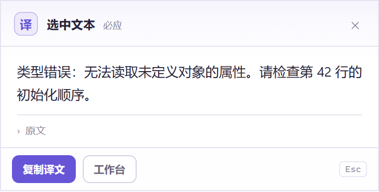

# 截译 ScreenLingo

[English](README.en.md) | 简体中文

Windows 上的本地截图 OCR、报错翻译和截图提问工具，适合把英文代码报错快速看懂。它也可以作为一层轻量的 Windows 浮层工作：截图译文直接覆盖原选区，选中文本的译文贴在光标旁，桌面右键即可开始。

## 下载

直接下载 [最新 Release](https://github.com/caoy2099-sketch/ScreenLingo/releases/latest)，或下载当前版本 v0.1.0：

| 文件 | 推荐场景 |
| --- | --- |
| [ScreenLingo-0.1.0-win-x64.zip](https://github.com/caoy2099-sketch/ScreenLingo/releases/download/v0.1.0/ScreenLingo-0.1.0-win-x64.zip) | 推荐。解压后运行 `win-unpacked/截译 ScreenLingo.exe`，请保留整个文件夹。 |
| [ScreenLingo-0.1.0-x64.exe](https://github.com/caoy2099-sketch/ScreenLingo/releases/download/v0.1.0/ScreenLingo-0.1.0-x64.exe) | 便携单文件。每次启动会先解压，启动速度较慢。 |
| [SHA256SUMS.txt](https://github.com/caoy2099-sketch/ScreenLingo/releases/download/v0.1.0/SHA256SUMS.txt) | 校验下载文件完整性。 |

程序暂未进行商业代码签名，首次启动时 Windows SmartScreen 可能显示“未知发布者”。请只从本仓库的 Releases 下载。

## Android 移动版体验

移动版把“截图/分享 → 本地识字 → 点选词句 → 翻译、提问或复制”带到 Android 8.0 及以上设备。它支持相册导入、系统分享、兼容应用的文字选择菜单和主动粘贴；截图只有在提问时主动勾选才会发送给配置的视觉模型。

当前版本为 `0.1.0-alpha.1`，可从 [Android alpha Release](https://github.com/caoy2099-sketch/ScreenLingo/releases/tag/mobile-v0.1.0-alpha.1) 下载个人体验包；尚未完成不同品牌手机的真机兼容性验收。默认翻译使用必应在线接口；手机上的系统 VPN/代理由 Android 网络栈处理，不会扫描电脑上的 v2rayN。源码、安装说明、隐私边界和构建验证记录见 [Android 移动版说明](mobile/README.md)。

## 三步开始

1. 下载并启动程序；首次使用可在“设置”中选择翻译服务。
2. 在任意窗口按 `Alt+Shift+S`，拖动框选英文报错。
3. 松开鼠标，等待本地 OCR 和翻译结果；译文会以轻量浮层覆盖刚才的截图选区。

也可以先选中文字，按 `Alt+Shift+X`，译文会以小窗出现在光标旁；或先复制文字，再按 `Alt+Shift+T` 翻译剪贴板内容。

## 贴近 Windows 的用法

- **截图即译**：快捷键或右键菜单开始框选，结果直接覆盖原选区，不把主窗口叫到前台。浮层可以复制译文、打开完整工作台，点关闭后不会因后台请求晚到而重新弹出。
- **选中即译**：`Alt+Shift+X` 通过 Windows UI Automation 读取当前应用的文字选区，在光标旁显示一个占比很小的结果窗；不会模拟 `Ctrl+C`，也不会改写剪贴板。
- **右键开始**：右键 Windows 桌面或文件夹空白处，选择“截译 · 截屏翻译”或“截译 · 翻译剪贴板”。Windows 11 中这些项目位于“显示更多选项”。系统托盘右键还提供“翻译选中文本”。默认会添加当前用户的菜单项，可在设置中关闭。
- **自动收回**：浮层不进入任务栏，靠近屏幕边缘会自动翻转或移动；关闭主窗口后程序默认驻留托盘。

Windows 不能把普通应用的项目插入所有软件的原生文本右键菜单；截译不做进程注入，所以“翻译选中文本”走全局快捷键和托盘入口。具体边界、注册表位置与卸载方式见 [Windows 集成说明](docs/WINDOWS_INTEGRATION.md)。

## 常用快捷键

| 操作 | 默认快捷键 |
| --- | --- |
| 截图翻译 | `Alt+Shift+S` |
| 翻译选中文本 | `Alt+Shift+X` |
| 翻译剪贴板 | `Alt+Shift+T` |
| 取消截图框选 | `Esc` |

快捷键可在设置中修改。关闭主窗口后程序默认驻留系统托盘，可在设置中关闭此行为。“设置 → 快捷键与行为 → Windows 桌面右键菜单”可以随时启用或移除资源管理器菜单项，只写入当前用户，不需要管理员权限。

## 截图提问

翻译工作区可以针对当前截图继续提问，例如询问错误原因或修复方向。此功能需要在设置中配置支持图片输入的 OpenAI 兼容视觉模型（例如本机 Ollama 的视觉模型）；普通文字模型或必应、Google 翻译不能处理截图提问。只有主动发送问题时，当前图片才会上传到你配置的模型端点。

## 网络设置

默认“自动”模式同时适用于 v2rayN 已开启和未开启的情况：

- v2rayN 开启时，优先使用系统代理或可用的本机代理端口。
- v2rayN 未开启或本机代理不可用时，自动尝试直连。
- 也可以在设置中明确选择系统代理、直连或手动代理，并填写 v2rayN 的实际端口。

程序不会启动、关闭或读取 v2rayN 的节点和订阅，也不会修改 Windows 系统代理。

## 隐私与限制

- OCR 在本机运行，随程序提供的模型目前只识别英文。
- 普通翻译只发送识别出的文字；截图只在主动使用“截图提问”时发送。
- 截图和识别结果默认只保存在内存中，不自动写入历史记录。
- 选中文本由 Windows UI Automation 在本机读取，只在你主动按热键或选择托盘菜单时发生；密码框会拒绝读取，不会模拟复制或改写剪贴板。
- 桌面右键菜单仅写入当前用户 `HKCU`，关闭设置开关即可移除；程序不注册服务、不开机启动、不修改文件关联。
- API Key 通过 Windows 安全存储加密保存；安全存储不可用时不会改用明文。
- 必应和 Google 模式依赖其网页接口，可能受到网络、限流或服务变化影响；需要稳定服务时请配置自己信任的 OpenAI 兼容端点。
- 默认翻译需要网络；完全离线使用需要本机模型。

更多数据流说明见[隐私说明](docs/PRIVACY.md)。发现安全问题请按[安全策略](SECURITY.md)私下报告；普通问题或建议请提交 [Issue](https://github.com/caoy2099-sketch/ScreenLingo/issues)。

## 参与项目

开发和 Pull Request 流程见[贡献指南](CONTRIBUTING.md)。

ScreenLingo 采用 [MIT License](LICENSE)，依赖许可见[第三方声明](THIRD_PARTY_NOTICES.md)。
