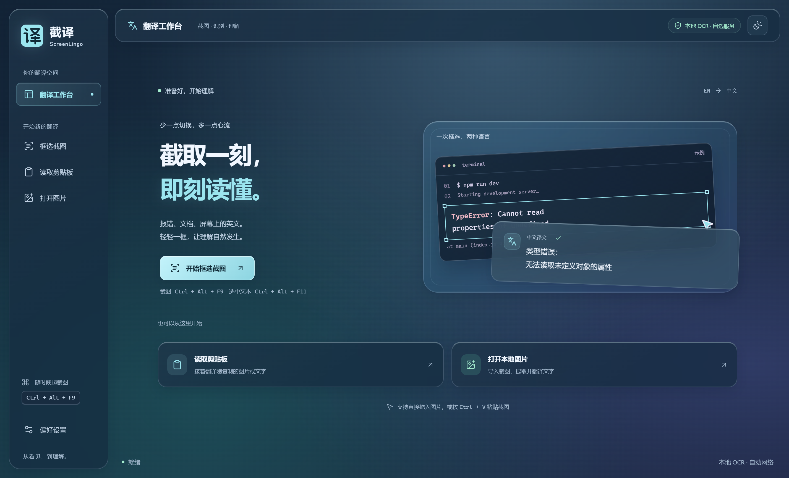
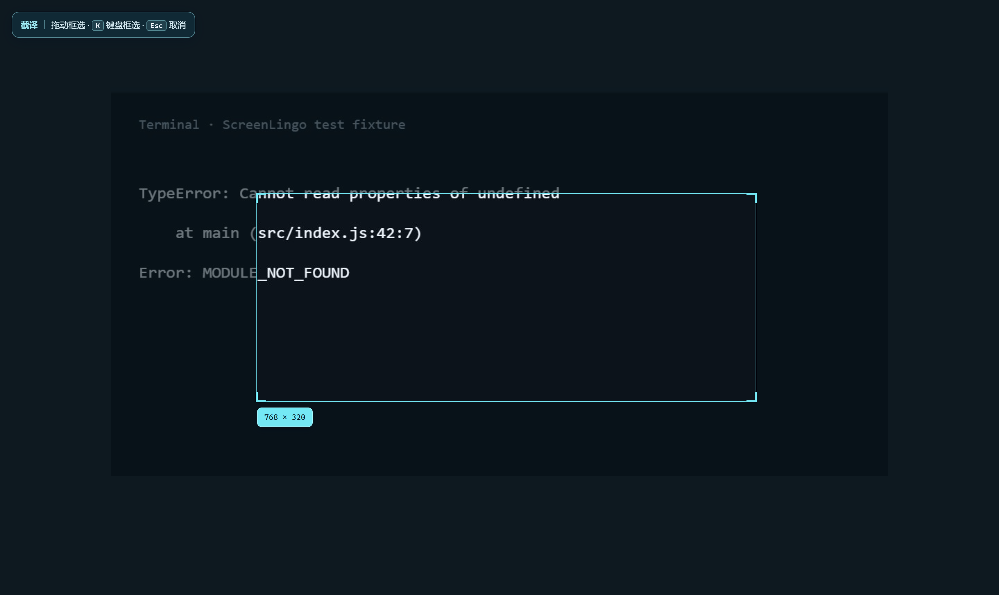
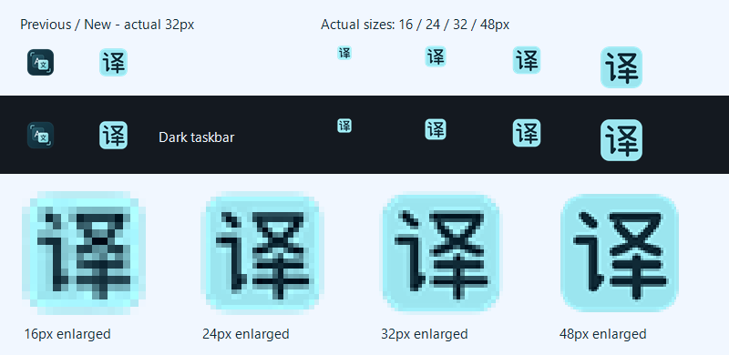

# 玻璃主题

在 Windows 版的「偏好设置 → 外观主题」选择「玻璃」，即可预览深海蓝底色、冰青色按钮和半透明面板；点击「保存设置」后，重新启动仍会使用此主题，截图翻译与选中文本的小窗也会同步。

首页、翻译工作台、设置页与结果浮窗使用同一组颜色。输入卡片会在鼠标经过时显示柔和高光，按钮有轻微按压反馈，页面和结果采用短距离淡入。系统启用「减少动态效果」时会关闭这些动画和跟随高光。

框选截图的提示条、辅助线、选区边框、尺寸标签和键帽也会跟随保存的主题，玻璃模式统一使用冰青色与深海蓝。

应用图标和 Logo 使用亮冰青色实心底与原创几何「译」字，增大主体、减少细节，让任务栏小尺寸更容易辨认。Windows 图标包含 16–256px 七档尺寸，主窗口和翻译浮窗使用本地矢量 Logo；Android 启动图标同步图形与配色。

## React Bits 参考

本次访问了 [React Bits](https://reactbits.dev/)，阅读相关公开示例与配置代码，并针对 Electron 的原生 HTML/CSS 界面独立实现：

| 参考 | 用到的设计思路 | 截译中的调整 |
| --- | --- | --- |
| [Glass Surface](https://reactbits.dev/components/glass-surface) | 磨砂表面、明暗边缘、透明叠层 | 面板使用 18px 背景模糊，阅读内容本身保持清晰；不支持模糊时使用实色背景 |
| [Glare Hover](https://reactbits.dev/animations/glare-hover) | 与鼠标移动对应的表面高光 | 只在首页两个输入卡片内启用，事件合并到单帧，离开、切页或窗口隐藏时停止 |
| [Animated Content](https://reactbits.dev/animations/animated-content) | 内容出现时保留空间连续性 | 6px 位移，240–340ms 淡入，不延迟按钮操作，也不循环播放背景动画 |

原项目源码：[GlassSurface](https://github.com/DavidHDev/react-bits/tree/main/src/content/Components/GlassSurface)、[GlareHover](https://github.com/DavidHDev/react-bits/tree/main/src/content/Animations/GlareHover)、[AnimatedContent](https://github.com/DavidHDev/react-bits/tree/main/src/content/Animations/AnimatedContent)。查阅时许可证为 [MIT + Commons Clause](https://github.com/DavidHDev/react-bits/blob/main/LICENSE.md)。本次没有复制或分发这些组件的源文件，没有引入 React、动画库或远程素材。

## 配置与维护

- `src/renderer/glass.css`：玻璃主题的颜色、透明度、模糊与动效参数，同时用于主窗口和快速翻译窗。
- `src/renderer/app.js`：首页高光的单帧更新及主题预览。
- `src/main/settings-store.js`：主题字段允许 `system`、`light`、`dark`、`glass`。
- `src/main/capture-service.js`、`src/renderer/capture.js`、`capture.css`：在框选窗口首次显示前应用主题，并统一截图辅助界面的颜色。
- `src/assets/icon.svg`、`logo-mark.svg`：应用图标和 Logo 的矢量源；`scripts/build-icons.ps1` 生成 Windows PNG/ICO。

玻璃质感由应用内部背景与面板形成，不会读取或显示窗口背后的其他应用。现有截图、翻译服务、网络代理和图片发送规则不变。系统减少透明度与强制颜色模式提供独立回退。

## 验收

`npm run test:glass` 使用独立设置目录和本机模拟翻译服务，检查主题保存与重载、窗口布局、键盘导航、鼠标高光、减少动态效果、高对比度和快速结果窗，并输出截图与报告到 `artifacts/glass/`。完整截图/OCR/提问流程继续使用 `npm run test:e2e`。

Windows 打包可通过 `SCREENLINGO_EXE` 指定解压版程序后复用玻璃验收，报告输出到 `artifacts/glass-packaged/`。

### 2026-11-01 验证记录

- JavaScript 语法检查、130 项单元测试和发布预检通过。
- Windows 打包成功；打包版玻璃专项 8 组检查、完整流程 15 组检查通过，覆盖框选主题、辅助线、键盘选区、真实框选、离线 OCR、取消与错误恢复。在线翻译与截图提问使用本机模拟服务验证。
- 已检查新 Logo 在主界面及结果浮窗的显示，未发现页面错误或 CSP 拦截；完成独立代码审查。
- Android `:app:processDebugResources` 成功；移动版完整构建和签名验证记录见 [Android 构建说明](../mobile/BUILDING.md)，真机显示仍待验证。
- 本机原 Electron 依赖目录存在启动权限问题；将同一运行时复制到正常权限的独立目录后完成构建和验证，全程保留沙箱。此问题无需更改应用安全配置。

玻璃主题随 [Windows v0.3.0](https://github.com/caoy2099-sketch/ScreenLingo/releases/tag/v0.3.0) 提供。Android [0.1.0-alpha.2](https://github.com/caoy2099-sketch/ScreenLingo/releases/tag/mobile-v0.1.0-alpha.2) 同步新的启动图标，界面仍为现有浅色／深色设计。
