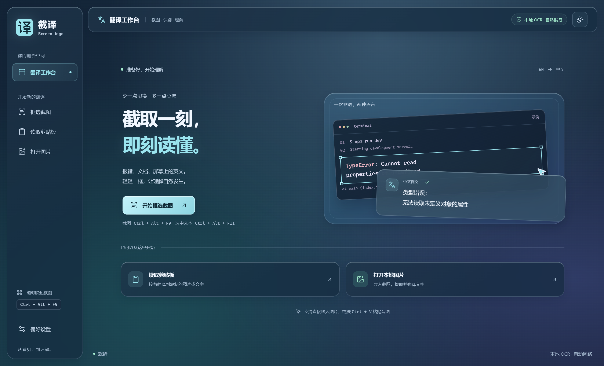

# 截译 ScreenLingo v0.3.0

这一版带来玻璃主题和更醒目的「译」字图标。工作台、翻译浮窗与框选界面统一使用深海蓝和冰青色，页面切换、按钮按压和卡片高光提供轻微反馈。

## 下载

- `ScreenLingo-0.3.0-win-x64.zip`（推荐）：完整解压后运行 `win-unpacked/截译 ScreenLingo.exe`，请保留整个文件夹。
- `ScreenLingo-0.3.0-x64.exe`：单文件便携版，每次启动会先解压，启动较慢。
- `SHA256SUMS.txt`：用于核对下载文件的 SHA-256。

适用于 Windows 10/11 x64，包含英文 OCR 模型，无需安装 Node.js。

## 更新内容

- **可选玻璃主题**：在「偏好设置 → 外观主题」选择「玻璃」并保存。设置会保留，翻译结果小窗同步切换。
- **框选配色修复**：提示条、辅助线、选区边框、尺寸标签和键帽跟随主题，玻璃模式下不再出现旧紫色。
- **更简洁的图标**：亮冰青色底配粗笔画「译」字，统一应用、托盘和界面 Logo，改善任务栏小尺寸辨识度。
- **克制的动效**：短距离淡入、按钮按压和输入卡片高光；支持减少动态效果、减少透明度和高对比度模式。

## 升级与使用

1. 从托盘菜单退出旧版，再解压或运行新版。
2. 同一 Windows 用户下，原有翻译服务、代理、快捷键和已保存的 API Key 会继续使用；主题不会被强制改动。
3. 在设置中选择「玻璃」并保存后，即可启用新外观。
4. 若任务栏或桌面快捷方式仍指向旧文件夹，请改为新版程序。

内存中的截图和结果不会跨退出保留，需要的内容请先复制。当前没有自动更新功能。

## 验证与限制

- 130 项单元测试通过；打包版完成 8 组玻璃主题检查和 15 组完整流程检查，覆盖真实框选、离线 OCR、键盘操作、取消及错误恢复。
- 翻译与截图提问使用本机模拟服务验证；线上服务可用性仍受网络、限流和服务变化影响。
- Windows 程序尚未进行商业代码签名，首次启动可能提示未知发布者。
- OCR 随包模型主要识别英文代码报错；选中文本翻译仍依赖目标应用提供选区信息。

Android 同期提供 [0.1.0-alpha.2](https://github.com/caoy2099-sketch/ScreenLingo/releases/tag/mobile-v0.1.0-alpha.2)，同步新图标；玻璃界面目前仅适用于 Windows。

更多使用方法见 [README](https://github.com/caoy2099-sketch/ScreenLingo/blob/v0.3.0/README.md)。
